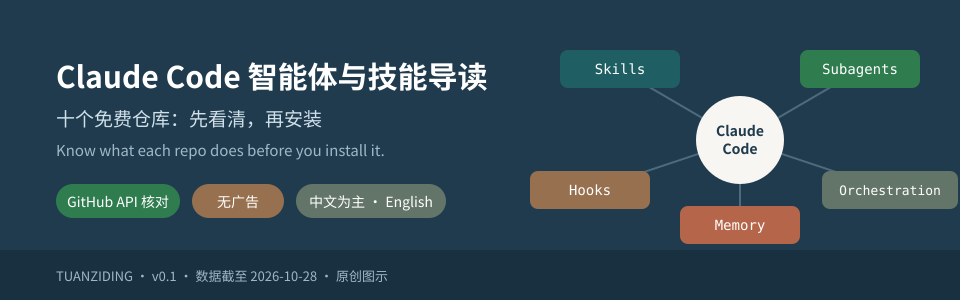
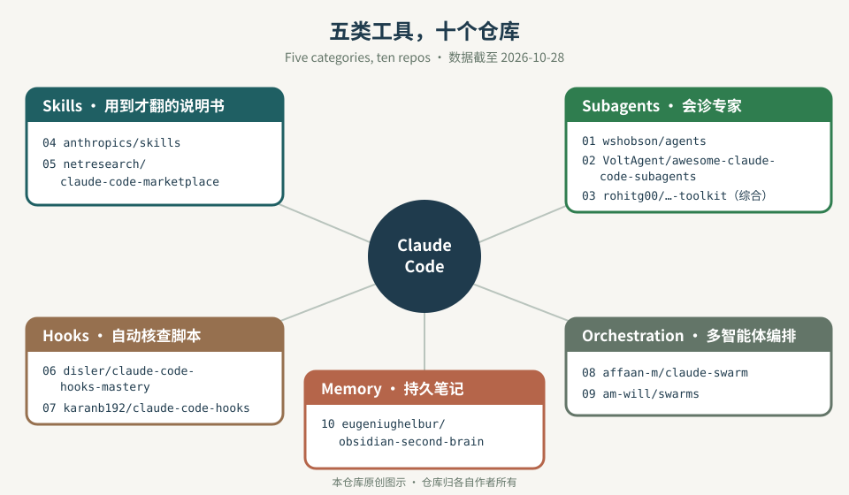
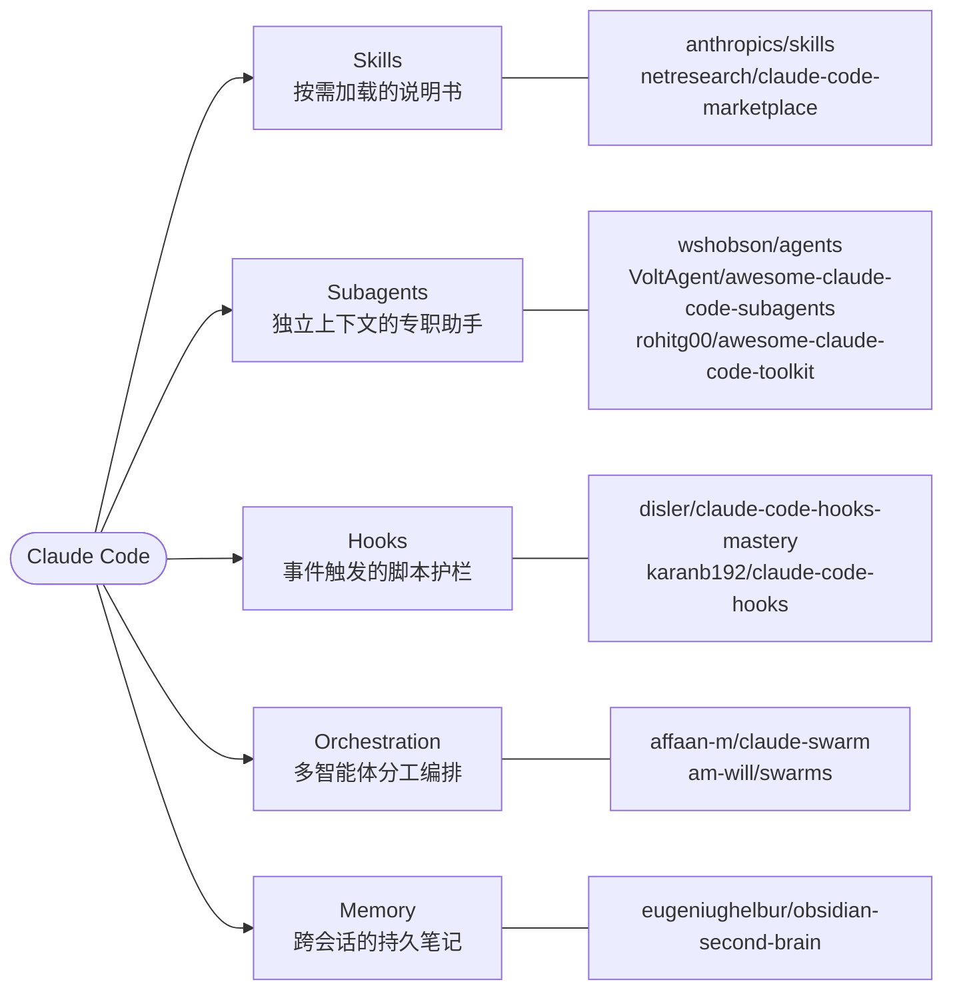
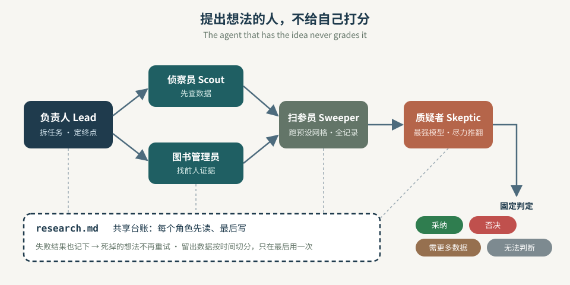

<p align="center">
  
</p>

<h1 align="center">Claude Code 智能体与技能导读 · Claude Code Agents &amp; Skills Guide</h1>

<p align="center">
  <strong>十个免费仓库，先看清是什么，再决定装不装。</strong><br>
  Ten free repos. Know what each one does before you install it.
</p>

<p align="center">
  面向想用 Claude Code 组建「AI 小队」的医生、科研人员和开发者：按五类整理 10 个开源仓库（数据经 GitHub API 核对），配入门示例、小队协作模式、医学科研改编和安装前安全清单。<br>
  For clinicians, researchers and developers building their first Claude Code "agent team": 10 open-source repos sorted into five categories (checked against the GitHub API), with starter examples, a team pattern, a medical-research adaptation and a pre-install safety checklist.
</p>

<p align="center">
  <a href="LICENSE"></a>
  
  <a href="docs/repo-catalog-v0.1.md"></a>
  
  
</p>

<p align="center">
  <code>五类生态图</code> · <code>仓库核对表</code> · <code>SKILL.md 入门</code> · <code>小队协作模式</code> · <code>医学科研改编</code> · <code>安装前安全清单</code>
</p>

<p align="center">
  <a href="#conclusion">一句话结论</a> ｜ <a href="#map">生态图</a> ｜ <a href="#repos">十个仓库</a> ｜ <a href="#first-team">先跑通一个小队</a> ｜ <a href="#safety">安全红线</a> ｜ <a href="#contents">目录结构</a> ｜ <a href="#sources">来源与致谢</a>
</p>

<p align="center"><sub>全部文字与 SVG 图示为本仓库原创。只做导读与核对，不复制被收录仓库的代码和图片；不含任何推广、带货或付费链接。与 Anthropic 及各被收录仓库无关。当前版本 0.1.0（2026-10-28）。</sub></p>

---

<a id="conclusion"></a>

## 一句话结论 · In one line

**先装官方 [anthropics/skills](https://github.com/anthropics/skills) 读懂一个 `SKILL.md`，再挑一个 Hook 仓库做安全护栏，最后才考虑多智能体编排；第一支小队只接一个有明确终点的任务，算清留下了多少产出、花了多少钱。**

> **English.** Start by reading one real `SKILL.md` in the official `anthropics/skills`, add a safety hook next, and only then try multi-agent orchestration. Give your first team one job with an obvious finish line, and measure what output you kept and what it cost.

<a id="map"></a>

## 五类生态图 · The five categories





| 类别 | 一句话 | 打个比方 |
| --- | --- | --- |
| **Skills** 技能 | 一个文件夹 + 一份 `SKILL.md`，Claude 需要时才读 | 科室的标准操作规程（SOP），用到才翻 |
| **Subagents** 子智能体 | `.claude/agents/` 里的 Markdown 文件，有自己的上下文和工具权限 | 会诊：请专科医生看完只回一份意见 |
| **Hooks** 钩子 | 在某个事件（如执行命令前）自动运行的 shell 脚本 | 手术前的核查表，不过关就停 |
| **Orchestration** 编排 | 把大任务拆给多个智能体并行，再汇总 | 多学科联合查房，有人主持、有人记录 |
| **Memory** 记忆 | 把结论写进 Markdown 文件，下次会话先读 | 病程记录，接班的人先看 |

> **English.** Skills are on-demand instruction folders; subagents are specialists with their own context; hooks are scripts fired by events; orchestration splits work across agents; memory is a markdown record every session reads first.

<a id="repos"></a>

## 十个仓库速览 · The ten repos

数据由 GitHub API 于 **2026-10-28** 读取（Stars 会持续变化）。「作者自述」= 仓库作者在描述或 README 中的说法，本仓库未逐项核实或计数口径不同。完整表格与上手建议见 **[仓库核对表](docs/repo-catalog-v0.1.md)**。

| # | 仓库 | 类别 | Stars | 许可 | 最近推送 | 一句话 |
| --- | --- | --- | ---: | --- | --- | --- |
| 01 | [wshobson/agents](https://github.com/wshobson/agents) | Subagents · Skills | 41,885 | MIT | 2026-10-26 | 插件市场，同一批智能体可装进 Claude Code、Codex、Cursor、Copilot 等 |
| 02 | [VoltAgent/awesome-claude-code-subagents](https://github.com/VoltAgent/awesome-claude-code-subagents) | Subagents | 26,116 | MIT | 2026-10-11 | 100+ 个按领域分类的子智能体 |
| 03 | [rohitg00/awesome-claude-code-toolkit](https://github.com/rohitg00/awesome-claude-code-toolkit) | 综合工具箱 | 2,775 | Apache-2.0 | 2026-05-12 ⚠️ | 智能体、技能、命令、钩子、MCP 配置大合集（数量为作者自述） |
| 04 | [anthropics/skills](https://github.com/anthropics/skills) | Skills | 184,266 | 混合 ⚠️ | 2026-10-10 | 官方 Agent Skills 示例库，看懂 `SKILL.md` 的最好起点 |
| 05 | [netresearch/claude-code-marketplace](https://github.com/netresearch/claude-code-marketplace) | Skills | 84 | MIT | 2026-10-26 | 遵循开放标准、可跨多种智能体使用的精选技能 |
| 06 | [disler/claude-code-hooks-mastery](https://github.com/disler/claude-code-hooks-mastery) | Hooks | 3,965 | 未声明 ⚠️ | 2026-03-05 | 覆盖各类钩子事件的参考实现 |
| 07 | [karanb192/claude-code-hooks](https://github.com/karanb192/claude-code-hooks) | Hooks | 565 | MIT | 2026-10-26 | 可一键安装的钩子：安全、成本、可观测性、效率 |
| 08 | [affaan-m/claude-swarm](https://github.com/affaan-m/claude-swarm) | Orchestration | 439 | MIT | 2026-02-11 ⚠️ | 任务拆解 + 多智能体协调 + 终端界面 |
| 09 | [am-will/swarms](https://github.com/am-will/swarms) | Orchestration | 245 | 见说明 ⚠️ | 2026-04-19 | 把编排能力做成技能（Skills） |
| 10 | [eugeniughelbur/obsidian-second-brain](https://github.com/eugeniughelbur/obsidian-second-brain) | Memory | 4,997 | MIT | 2026-10-28 | 用 Obsidian 里的 Markdown 做多个智能体共享的持久记忆 |

⚠️ 说明：03、06、08、09 最近推送距今超过 5 个月（截至 2026-10-28），可能跟不上 Claude Code 新版本；04 根目录无统一许可证，多数技能为 Apache-2.0，但 `docx`、`pdf`、`pptx`、`xlsx` 为「源码可见、非开源」；06 未声明任何许可证，默认保留所有权利；09 的 README 写明 MIT，但仓库内没有 LICENSE 文件，GitHub 识别为无许可。10 个仓库均存在、均未归档（archived = false）。

> **English.** All ten repos exist and none is archived (as of 2026-10-28). Four have not been pushed for 5+ months. `anthropics/skills` mixes Apache-2.0 with source-available skills; `disler/claude-code-hooks-mastery` declares no license; `am-will/swarms` says MIT in its README but ships no LICENSE file.

<a id="first-team"></a>

## 先跑通一个小队 · Run one small team first



原帖作者的建议，换成我们的话：

1. **第一个任务要有明确终点。** 一个通过评审的 PR、一份查证过的简报、一个从红变绿的失败测试——做完就是做完。
2. **只算留下来的东西。** 记下最终采用了多少产出、花了多少 token 和时间；没被采用的，再多也不算成绩。
3. **扩编要先证明自己。** 多一个智能体就多一份成本和协调开销，它必须带来看得见的增量才留下。

再加一条从另一篇讨论里提炼的通用方法：**提出想法的智能体不给自己打分**，所有成员先读、最后写同一份台账（如 `research.md`），失败的结果也记下来，免得死掉的想法被反复重试。详见 **[小队协作模式](docs/agent-team-pattern-v0.1.md)**，其中有一节专门改编到**文献综述**和**公共数据库流行病学分析**。

> **English.** One job with a finish line; count only the output you kept and its cost; every extra agent must earn its seat. The agent that proposes an idea never grades it, and a shared ledger records negative results so dead ideas stay dead.

<a id="safety"></a>

## 安全红线 · Safety red lines

> ⚠️ **安装任何仓库之前**
> - 🔍 **Hook 会执行 shell 命令**：权限和你本人一样。逐行读完脚本再装
> - 📜 **先看许可证**：无许可 ≠ 可随意复制；源码可见 ≠ 开源
> - 🔒 **最小权限**：子智能体只给需要的工具，不开 `bypassPermissions`
> - 🔑 **不贴密钥**：API Key 只放环境变量，不写进提示词、`SKILL.md` 或台账
> - 🏥 **不传患者信息**：可识别个人身份的临床数据不进任何云端模型

完整清单见 **[安装前安全清单](docs/safety-checklist-v0.1.md)**。

> **English.** Hooks run shell commands with your permissions — read every line first. Check the license. Grant least privilege. Keep API keys in environment variables. Never send identifiable patient data to a cloud model.

## 从哪里开始 · Where to start

| 你是 | 建议先看 |
| --- | --- |
| 完全没用过 Skills / Subagents | [入门：三个概念 + 最小示例](docs/getting-started-v0.1.md) |
| 想挑仓库 | [仓库核对表](docs/repo-catalog-v0.1.md) |
| 想让多个智能体协作做研究 | [小队协作模式](docs/agent-team-pattern-v0.1.md) |
| 准备安装别人的 Hook 或插件 | [安装前安全清单](docs/safety-checklist-v0.1.md) |

<a id="contents"></a>

## 目录结构 · Contents

```
claude-code-agent-skills-guide-/
├── README.md                          # 本页：结论、生态图、速览、红线（中英对照）
├── LICENSE                            # MIT（仅覆盖本仓库原创内容）
├── assets/                            # 原创 SVG 图示
│   ├── cover-v0.1.svg
│   ├── ecosystem-map-v0.1.svg
│   └── agent-team-flow-v0.1.svg
├── docs/
│   ├── repo-catalog-v0.1.md           # 10 个仓库核对表：用途、类别、Stars、许可、更新、适合谁、上手建议
│   ├── getting-started-v0.1.md        # SKILL.md、子智能体、Hooks、插件市场 + 最小示例
│   ├── agent-team-pattern-v0.1.md     # 小队协作模式 + 医学科研改编 + 台账模板
│   ├── safety-checklist-v0.1.md       # 安装前安全清单
│   └── sources-v0.1.md                # 来源、致谢与核对方法
└── tools/
    └── check-repo-v0.1.py             # 本地检查：命名、链接、SVG、防误提交密钥
```

```sh
git clone https://github.com/TUANZIDING/claude-code-agent-skills-guide-.git
cd claude-code-agent-skills-guide-
python3 tools/check-repo-v0.1.py      # 只依赖 Python 3 标准库
```

## 一起把它做得更准 · Contribute

Stars、许可或安装方式变了，或者你有值得收录的仓库，欢迎在 [Issues](https://github.com/TUANZIDING/claude-code-agent-skills-guide-/issues) 反馈。提交 PR 前请运行 `tools/check-repo-v0.1.py`；新文件名带版本号、不用下划线（README.md、LICENSE 除外）。

## 声明 · Disclaimer

本仓库只做导读与公开信息核对，不为任何被收录仓库的安全性或可用性背书。Claude 与 Claude Code 是 Anthropic 的商标，本仓库与 Anthropic 及被收录仓库的作者无任何关联。涉及临床数据的任何用法，以所在机构的伦理与数据管理规定为准。

<a id="sources"></a>

## 来源与致谢 · Sources and credits

- 仓库清单与「第一支小队」的建议来自 X 用户 [@thedelost](https://x.com/thedelost) 2026-10-24 的帖子；本仓库为独立重写，并逐一用 GitHub API 核对
- 角色分工与共享台账的方法，提炼自该帖引用的 [@hanakoxbt](https://x.com/hanakoxbt) 的长文；原文中的产品推广与链接已全部删除，只保留通用方法
- 10 个仓库归其各自作者所有，许可以各仓库为准；完整致谢与核对方法见 [来源与致谢](docs/sources-v0.1.md)
- 概念说明参考 [Claude Code 官方文档](https://code.claude.com/docs/en/sub-agents)（2026-10-28 访问）
- 本仓库原创文档、SVG 与脚本 · [MIT](LICENSE) © 2026 Haixiang Ding (TUANZIDING)

---

<p align="center">
  <strong>Claude Code 智能体与技能导读 · Claude Code Agents &amp; Skills Guide</strong><br>
  先读懂，再安装；先跑通，再扩编。<br>
  <a href="https://github.com/TUANZIDING">TUANZIDING</a> · <a href="LICENSE">MIT</a>
</p>
