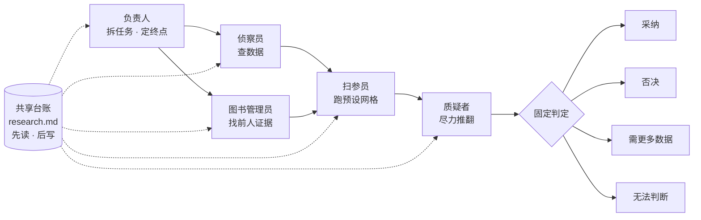

# 小队协作模式 · The Agent Team Pattern

[← 返回首页](../README.md) ｜ [仓库核对表](repo-catalog-v0.1.md) ｜ [入门](getting-started-v0.1.md) ｜ [安全清单](safety-checklist-v0.1.md)

**一句话：一个负责人定计划，几个角色各干一件事，提出想法的人不给自己打分，所有人先读、最后写同一份台账，结论只能落进事先定好的几个格子。**

> **English.** One lead plans; each role does one job; whoever proposes an idea never grades it; everyone reads a shared ledger first and writes to it last; every result lands in one of a few fixed verdicts.


## 1. 先跑通，再扩编 · Start small

来自原帖的三条建议，用我们的话重写：

| 原则 | 做法 | 反面例子 |
| --- | --- | --- |
| 任务要有明确终点 | 一个通过评审的 PR；一份查证过的简报；一个从失败变通过的测试 | 「帮我优化一下项目」「研究一下这个领域」 |
| 只算留下来的产出 | 记录：采用了几条结论 / 几行代码、花了多少 token 和时间 | 只看智能体「干了多少活」 |
| 扩编要先证明价值 | 新角色上线前后对比同一类任务的保留率和成本 | 一上来就装 100 个子智能体 |

## 2. 角色分工 · Roles

| 角色 | 职责 | 绝不做 |
| --- | --- | --- |
| **负责人 Lead** | 拆任务、定终点、分配角色、汇总判定 | 自己做实验又自己验收 |
| **侦察员 Scout** | 先检查数据：来源、字段、缺失、口径是否和假设一致 | 在数据没查清前跑分析 |
| **扫参员 Sweeper** | 按事先列好的参数网格系统地跑一遍，全部记录 | 只报告最好看的那一组 |
| **质疑者 Skeptic** | 用最强的模型、最强的反例去推翻结论 | 评价自己提出的想法 |
| **图书管理员 Librarian** | 找已有证据：前人做过没有、结论如何 | 用「没搜到」代替「不存在」 |

核心规则：**有想法的智能体，永远不给这个想法打分。** 提出者和评审者分开，就像论文作者不能当自己的审稿人。



## 3. 共享台账 · The shared ledger

所有角色**开工先读台账，收工最后写台账**。台账里必须记录失败的尝试——这样死掉的想法不会被下一个智能体换个说法再试一遍。

台账模板（文件名示例：`research.md`，内容均为占位符）：

```markdown
# 研究台账 · <PROJECT-NAME>

## 目标与终点
- 问题：<一句话>
- 完成标志：<可检验的终点，如"得到一份经质疑者审过的结论">
- 预算上限：<token / 时间>

## 已否决（不要再试）
| 日期 | 想法 | 谁提出 | 谁评审 | 否决理由 |
| --- | --- | --- | --- | --- |
| <YYYY-MM-DD> | <想法> | <角色> | <另一个角色> | <证据> |

## 进行中
| 想法 | 负责角色 | 当前判定 | 下一步 |
| --- | --- | --- | --- |

## 已采纳
| 结论 | 证据 | 留出验证结果 | 评审角色 |
| --- | --- | --- | --- |

## 成本记录
| 日期 | 任务 | 消耗 | 采纳的产出 |
| --- | --- | --- | --- |
```

## 4. 固定判定类别 · Fixed verdicts

事先定好只有四个格子，任何结论必须落进其中之一，不能写「看起来不错」：

| 判定 | 含义 | 下一步 |
| --- | --- | --- |
| **采纳 KEEP** | 通过质疑者审查，且在留出数据上成立 | 写入「已采纳」 |
| **否决 KILL** | 被反例推翻，或在留出数据上不成立 | 写入「已否决」并注明理由 |
| **需更多数据 NEEDS-DATA** | 方向合理，但现有数据不足以判断 | 写明缺什么数据 |
| **无法判断 INCONCLUSIVE** | 结果互相矛盾或方法有缺陷 | 写明缺陷，由负责人决定是否重做 |

## 5. 按时间切分的留出验证 · Time-split hold-out

把数据按时间切开：**用早期数据提出和调整想法，用较晚、从未看过的数据做最终验证。** 这样可以防止「在同一批数据上反复试，直到试出一个好看结果」。留出数据只在最后用一次，用过即不再参与调参。

## 6. 改编到医学与科研 · Adapting to medical research

> 以下为本仓库的改编示例，供思路参考。AI 的输出必须由研究者本人核实；涉及患者数据时，以所在机构的伦理审查和数据管理规定为准。

### 6.1 文献综述 · Literature review

| 角色 | 在文献综述里做什么 |
| --- | --- |
| 负责人 | 用 PICO 写清问题和纳入/排除标准，定终点（如「一份 20 篇以内、经核对引用的证据摘要」） |
| 侦察员 | 检查检索式：主题词与自由词是否覆盖、数据库是否齐全、去重后的数量 |
| 图书管理员 | 先查是否已有同题的系统综述或注册方案（如 PROSPERO），避免重复劳动 |
| 扫参员 | 按预设的几套检索式和纳入标准变体分别跑，记录每套命中数（便于画 PRISMA 流程图） |
| 质疑者 | 逐篇做偏倚风险评估（如 RoB 2、ROBINS-I），抽查数据提取是否与原文一致 |

额外规则：**每一条引用都要回到原文核对**（DOI / PMID 能打开、作者年份一致、数字与原文一致），模型编造参考文献是常见问题。台账里记下「检索过但没有结果」的检索式，下次不用再试。

### 6.2 公共数据库流行病学分析 · Public-database epidemiology

以 NHANES、MIMIC-IV、SEER、UK Biobank 一类公共或受控数据库为例：

| 角色 | 在数据库分析里做什么 |
| --- | --- |
| 负责人 | 先写分析计划：暴露、结局、协变量集、主分析和敏感性分析，**写完再看数据** |
| 侦察员 | 查数据字典、变量定义随周期的变化、缺失比例、复杂抽样权重（如 NHANES）是否需要使用 |
| 图书管理员 | 查同一数据库是否已有人发表过同一暴露—结局组合 |
| 扫参员 | 只跑分析计划里预设的几套模型（协变量组合、亚组），**全部结果都报告**，不挑 |
| 质疑者 | 检查反向因果、残余混杂、多重比较；可用 E 值、阴性对照结局等方法压力测试 |

**时间切分示例**：用较早的调查周期或入院年份建立和调整模型，用较晚的周期 / 年份做外部时间验证（报告规范可参考 TRIPOD）。

**数据合规**：MIMIC 需要 PhysioNet 认证和培训，UK Biobank 需要获批申请；受控数据通常不允许上传到未经许可的第三方服务。把数据留在本地，只让智能体读写分析代码和汇总结果。

> **English.** For a literature review: the lead writes PICO and the finish line, the scout checks search strings, the librarian looks for existing reviews, the sweeper runs predefined search variants, the skeptic assesses risk of bias — and every citation is checked against the source. For public-database epidemiology: write the analysis plan before touching data, run only prespecified models and report all of them, let the skeptic stress-test for reverse causation and residual confounding, validate on a later time period, and respect each database's data-use agreement.

## 7. 和本仓库收录的工具怎么对应 · Mapping to the repos

| 你需要 | 可以参考 |
| --- | --- |
| 角色定义（侦察员、质疑者等） | 写成 `.claude/agents/` 里的子智能体；模板可参考 02 VoltAgent、01 wshobson |
| 固定流程（如 PICO、偏倚评估步骤） | 写成 Skill；结构参考 04 anthropics/skills |
| 「先读台账、后写台账」的强制执行 | 用 `SessionStart` / `Stop` 钩子提醒或检查；参考 06、07 |
| 多角色并行 | 08 claude-swarm、09 am-will/swarms |
| 台账跨会话、跨工具共享 | 10 obsidian-second-brain，或项目里一份普通的 `research.md` |

## 来源 · Source

本页方法提炼自 X 用户 @thedelost 2026-10-24 的帖子及其引用的 @hanakoxbt 长文。原文中的产品推广、链接和交易相关内容已全部删除，只保留与具体产品无关的通用方法，并由本仓库重新组织、改编到医学科研场景。
