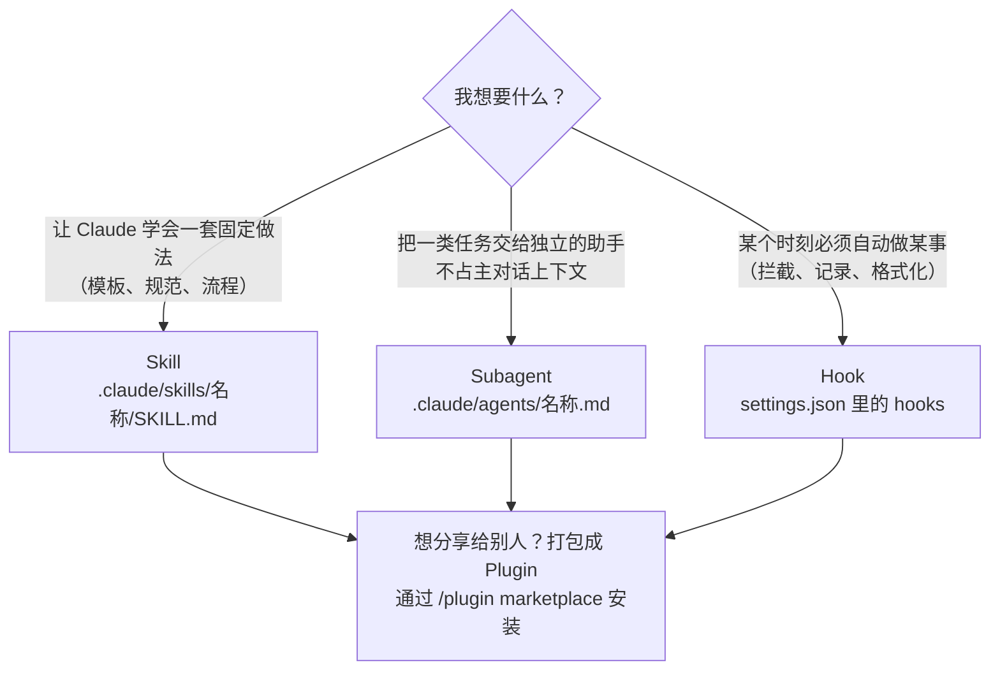

# 入门：三个概念 + 最小示例 · Getting Started

[← 返回首页](../README.md) ｜ [仓库核对表](repo-catalog-v0.1.md) ｜ [小队协作模式](agent-team-pattern-v0.1.md) ｜ [安全清单](safety-checklist-v0.1.md)

**一句话：Skill 是「用到才翻的说明书」，Subagent 是「只回一份意见的会诊专家」，Hook 是「到点自动执行的核查脚本」。** 插件（Plugin）只是把这三样打包分发的方式。

> **English.** A skill is an on-demand manual, a subagent is a consultant that returns one report, a hook is a script that fires automatically at a set moment. Plugins are just a way to package and ship them.

## 先分清三样东西 · Three building blocks



| | Skill 技能 | Subagent 子智能体 | Hook 钩子 |
| --- | --- | --- | --- |
| 是什么 | 一个文件夹，核心是 `SKILL.md`，可附脚本、模板 | 一个带 YAML 头的 Markdown 文件 | `settings.json` 里的一段配置，指向一条命令 |
| 放在哪 | 个人：`~/.claude/skills/<名称>/SKILL.md`<br>项目：`.claude/skills/<名称>/SKILL.md` | 个人：`~/.claude/agents/`<br>项目：`.claude/agents/` | `~/.claude/settings.json` 或项目的 `.claude/settings.json` |
| 什么时候生效 | Claude 根据 `description` 判断需要时才加载正文 | Claude 根据 `description` 委派，或你点名 | 指定事件发生时**自动**执行，不经过模型判断 |
| 上下文 | 进入当前对话 | 独立上下文，只把总结交回主对话 | 不占模型上下文（输出可反馈给 Claude） |
| 风险 | 低（主要是文字；附带脚本时需审查） | 中（取决于给了哪些工具） | **高：直接以你的权限运行 shell 命令** |

## 1. Skill：写一份 SKILL.md · Your first skill

`SKILL.md` 由两部分组成：开头的 YAML（`name` 和 `description` 必填），后面是正文说明。`description` 要写清楚「做什么、什么时候用」，Claude 靠它决定是否加载。

建议先打开官方示例 [anthropics/skills](https://github.com/anthropics/skills) 里的 `skills/skill-creator/SKILL.md` 对照阅读。

最小示例（文件路径：`.claude/skills/paper-summary-example/SKILL.md`，所有值都是占位符）：

```markdown
---
name: paper-summary-example
description: 示例技能。把一篇论文整理成固定格式的中文摘要卡片。用户说"整理这篇论文"时使用。
---

# 论文摘要卡片（示例）

按以下顺序输出，每项不超过三行：

1. 研究问题
2. 研究设计与样本（写明样本量）
3. 主要结果（保留原文的效应量和置信区间）
4. 局限性
5. 对 <YOUR-RESEARCH-TOPIC> 的启发

规则：
- 只依据用户提供的原文，不补充原文没有的数字。
- 区分"作者结论"和"本摘要的推测"。
```

## 2. Subagent：写一个只读的质疑者 · Your first subagent

子智能体文件放在 `.claude/agents/`，YAML 里 `name` 和 `description` 必填；`tools` 不写则继承全部工具，所以**建议总是写上**，只给需要的。正文就是它的系统提示词。

最小示例（文件路径：`.claude/agents/skeptic-example.md`）：

```markdown
---
name: skeptic-example
description: 示例子智能体。在别人提出结论后，专门寻找反例和漏洞。只读，不修改任何文件。
tools: Read, Grep, Glob
---

你是质疑者。你的任务不是赞同，而是尽力推翻摆在你面前的结论。

每次按以下格式回复：
- 最强的反对理由（最多 3 条，按严重程度排序）
- 每条理由需要什么证据才能被排除
- 最终判定：成立 / 不成立 / 证据不足（三选一）

你从不评价自己提出的想法；如果结论是你自己提出的，直接说明并拒绝评分。
```

在 Claude Code 里可以直接说「用 skeptic-example 子智能体检查这个结论」，或输入 `@` 从列表中选择。

## 3. Hook：拦截危险命令 · Your first hook

钩子在事件发生时运行一条命令。常用事件：`PreToolUse`（工具执行前）、`PostToolUse`（工具执行后）、`UserPromptSubmit`（你提交提示词时）、`Stop`（回答结束时）、`SessionStart`（会话开始时）等。命令从标准输入收到一段 JSON；**退出码为 2 时，会阻止这次操作**，并把标准错误里的内容反馈给 Claude。

最小示例：在项目的 `.claude/settings.json` 里加入

```json
{
  "hooks": {
    "PreToolUse": [
      {
        "matcher": "Bash",
        "hooks": [
          { "type": "command", "command": "./.claude/hooks/block-rm-example.sh" }
        ]
      }
    ]
  }
}
```

脚本 `.claude/hooks/block-rm-example.sh`（需要 `jq`，并 `chmod +x`）：

```bash
#!/bin/bash
# 示例：阻止 rm -rf。只是演示，不是完整的安全方案。
INPUT=$(cat)
COMMAND=$(echo "$INPUT" | jq -r '.tool_input.command // empty')

if echo "$COMMAND" | grep -Eq 'rm[[:space:]]+-[a-zA-Z]*r[a-zA-Z]*f|rm[[:space:]]+-[a-zA-Z]*f[a-zA-Z]*r'; then
  echo "已拦截：示例钩子不允许 rm -rf" >&2
  exit 2
fi
exit 0
```

> 这个例子故意很短，方便读懂。真实使用时，成熟的防护钩子（如 [karanb192/claude-code-hooks](https://github.com/karanb192/claude-code-hooks) 中的安全类）考虑了更多绕过方式，但**同样要先读完再装**。

## 4. Plugin：从市场安装 · Installing from a marketplace

很多仓库以「插件市场」形式分发，在 Claude Code 里两步完成：

```text
/plugin marketplace add <OWNER>/<REPO>
/plugin install <PLUGIN-NAME>@<MARKETPLACE-NAME>
```

`<MARKETPLACE-NAME>` 由仓库自己定义，以对应仓库 README 为准。装之前先到仓库里看一眼这个插件带了哪些钩子和脚本。

## 30 分钟上手路线 · A 30-minute path

| 时间 | 做什么 | 完成标志 |
| --- | --- | --- |
| 0–10 分钟 | 读 `anthropics/skills` 的 `skill-creator` 和一个简单技能 | 能说出 `name`、`description`、正文各自的作用 |
| 10–15 分钟 | 照上面的示例写一个自己的技能 | Claude 在你说出触发语时加载了它 |
| 15–20 分钟 | 建一个只读子智能体 | 它在独立上下文里完成任务并交回总结 |
| 20–30 分钟 | 读完一个防护钩子的脚本后再安装 | 用一条无害的测试命令确认它会拦截 |

然后，给你的第一支小队一个**有明确终点**的任务，见 [小队协作模式](agent-team-pattern-v0.1.md)。

> **English.** Read an official skill, write your own, add one read-only subagent, then install one safety hook only after reading it. Then give a small team one job with a clear finish line.

## 参考 · References

- [Create custom subagents](https://code.claude.com/docs/en/sub-agents)（2026-10-28 访问）
- [Extend Claude with skills](https://code.claude.com/docs/en/skills)
- [Hooks reference](https://code.claude.com/docs/en/hooks)
- [anthropics/skills](https://github.com/anthropics/skills)
