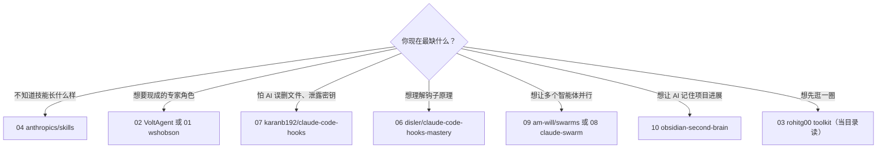

# 仓库核对表 · Repo Catalog

[← 返回首页](../README.md) ｜ [入门](getting-started-v0.1.md) ｜ [小队协作模式](agent-team-pattern-v0.1.md) ｜ [安全清单](safety-checklist-v0.1.md)

**数据截至 2026-10-28（北京时间上午），来源：GitHub REST API `GET /repos/{owner}/{repo}`。** Stars 每天在变，表中数字只代表那一刻。「最近推送」取 API 的 `pushed_at`，换算为北京时间日期。

| 标记 | 含义 |
| --- | --- |
| 作者自述 | 仓库描述或 README 里的说法，本仓库未逐项核实 |
| 本地计数 | 本仓库浅克隆后用文件数粗略统计；统计口径（是否含示例、索引、重复文件）可能与作者不同，仅供参考 |
| ⚠️ | 需要特别留意：许可证不清、长期未更新等 |

## 总表 · Summary

| # | 名称 | 用途 | 类别 | Stars | License | 最近更新 | 适合谁 | 上手建议 |
| --- | --- | --- | --- | ---: | --- | --- | --- | --- |
| 01 | [wshobson/agents](https://github.com/wshobson/agents) | 多平台插件市场：同一套智能体、技能可装进 Claude Code、Codex、Cursor、OpenCode、GitHub Copilot 等 | Subagents · Skills | 41,885 | MIT | 2026-10-26 | 同时用多个 AI 编程工具、想统一配置的人 | 先只装一个与你语言/领域相关的插件，看清它带来了哪些智能体，再决定加不加 |
| 02 | [VoltAgent/awesome-claude-code-subagents](https://github.com/VoltAgent/awesome-claude-code-subagents) | 100+ 个按领域分类的专职子智能体 | Subagents | 26,116 | MIT | 2026-10-11 | 想快速找到某类专家（如安全审查、数据分析）模板的人 | 挑 1–2 个文件手动复制到 `.claude/agents/`，读一遍提示词并收紧 `tools` 再用 |
| 03 | [rohitg00/awesome-claude-code-toolkit](https://github.com/rohitg00/awesome-claude-code-toolkit) | 智能体、技能、命令、插件、钩子、规则、MCP 配置的大合集 | 综合工具箱 | 2,775 | Apache-2.0 | 2026-05-12 ⚠️ | 想浏览整个生态、找灵感的人 | 当「目录」读，不要整包安装；钩子和 MCP 配置逐个审查 |
| 04 | [anthropics/skills](https://github.com/anthropics/skills) | Anthropic 官方 Agent Skills 示例库与规范 | Skills | 184,266 | 混合 ⚠️ | 2026-10-10 | 所有人，尤其是第一次写技能的人 | 打开 `skills/skill-creator/SKILL.md` 和任一简单技能，对照理解 frontmatter 与正文结构 |
| 05 | [netresearch/claude-code-marketplace](https://github.com/netresearch/claude-code-marketplace) | 遵循开放 Agent Skills 标准、可跨 30 多种智能体使用的精选技能目录（作者自述） | Skills | 84 | MIT | 2026-10-26 | 做 PHP / TYPO3 / Go / Docker 等开发、想要跨工具可移植技能的人 | 先看目录页里与你技术栈相关的条目，再用插件市场命令安装单个包 |
| 06 | [disler/claude-code-hooks-mastery](https://github.com/disler/claude-code-hooks-mastery) | 覆盖各类钩子事件的参考实现与讲解 | Hooks | 3,965 | 未声明 ⚠️ | 2026-03-05 ⚠️ | 想系统理解 Hooks 生命周期的人 | 当教材读：对照 `.claude/hooks/` 里每个事件的脚本，理解输入输出；复制代码前注意无许可证 |
| 07 | [karanb192/claude-code-hooks](https://github.com/karanb192/claude-code-hooks) | 可单独安装的钩子插件，分安全、成本、可观测性、效率四类 | Hooks | 565 | MIT | 2026-10-26 | 想马上加一道安全护栏的人 | 读完脚本后，先装一个防护类（如阻止读取密钥文件、阻止危险命令）的钩子 |
| 08 | [affaan-m/claude-swarm](https://github.com/affaan-m/claude-swarm) | 多智能体编排：拆解任务、协调并行、终端界面实时显示进度与成本 | Orchestration | 439 | MIT | 2026-02-11 ⚠️ | 已熟悉单个智能体、想试并行编排的开发者 | README 要求设置 `ANTHROPIC_API_KEY`，会产生 API 费用（本仓库推测）；先在小项目上跑并设预算 |
| 09 | [am-will/swarms](https://github.com/am-will/swarms) | 把多智能体编排做成一组技能（规划、并行任务等） | Orchestration | 245 | 见说明 ⚠️ | 2026-04-19 ⚠️ | 想用「技能」而不是独立程序来编排的人 | 先读 `swarm-planner` 技能，理解它如何拆任务，再决定是否用并行版本 |
| 10 | [eugeniughelbur/obsidian-second-brain](https://github.com/eugeniughelbur/obsidian-second-brain) | 把持久记忆存成 Obsidian 库里的 Markdown，供多个智能体共享 | Memory | 4,997 | MIT | 2026-10-28 | 已经用 Obsidian 做笔记、想让 AI 记住项目进展的人 | 官方给的一键安装是 `curl … \| bash`：先下载脚本读完再执行；建议先用一个测试库 |

所有 10 个仓库在 2026-10-28 均存在、均未归档（`archived: false`）、均非 fork。

> **English.** As of 2026-10-28 all ten repos exist, none is archived and none is a fork. Stars and push dates come from the GitHub REST API.

## 逐个说明 · Notes per repo

### 01 wshobson/agents

- **API 描述**：多平台智能体插件市场，面向 Claude Code、Codex、Cursor、OpenCode、GitHub Copilot、Google Antigravity、Pi。
- **本地计数**：`plugins/` 下 92 个插件目录，185 个 `SKILL.md`，`agents/` 下 776 个 Markdown 文件（未去重，可能含同一智能体在多个插件中的副本）。
- **安装方式（作者 README）**：Claude Code 中先添加市场 `/plugin marketplace add wshobson/agents`，再按插件名安装。
- **留意**：体量很大，整包安装会让子智能体描述占用大量上下文；官方文档提示子智能体描述合计超过 15,000 token 会在启动时警告。

### 02 VoltAgent/awesome-claude-code-subagents

- **API 描述**：100+ 个专职 Claude Code 子智能体。
- **本地计数**：`categories/` 下 163 个智能体文件（不含各分类 README），与「100+」的说法一致。
- **安装方式（作者 README）**：插件市场，或把单个文件复制到 `~/.claude/agents/`（全局）/ `.claude/agents/`（项目），也提供安装脚本。
- **留意**：用安装脚本前先读脚本；手动复制单个文件最可控。

### 03 rohitg00/awesome-claude-code-toolkit

- **作者自述**：135 个智能体、35 个技能、42 个命令、176+ 个插件、20 个钩子、14 个 MCP 配置等。
- **本地计数（口径可能不同）**：`agents/` 136 个 Markdown，`skills/` 40 个 `SKILL.md`，`commands/` 42 个，`plugins/` 120 个目录，`hooks/hooks.json` 25 条钩子配置、`hooks/scripts/` 20 个脚本，`mcp-configs/` 16 个文件。「176+ 插件」可能包含 README 中列出的外部项目，本仓库未核实。
- ⚠️ **更新**：最近推送 2026-05-12，已超过 5 个月。

### 04 anthropics/skills

- **API 描述**：Agent Skills 公共仓库。
- **本地计数**：`skills/` 下 19 个技能，各有 `SKILL.md`；另有 `spec/`（规范）和 `template/`（模板）。
- ⚠️ **许可（已核对每个技能的 LICENSE.txt）**：15 个为 Apache-2.0；`docx`、`pdf`、`pptx`、`xlsx` 4 个为 Anthropic 版权所有、「源码可见、非开源」（README 原意）。GitHub API 因根目录无统一许可证而显示为空。
- **作者声明**：这些技能用于演示和教学，Claude 实际行为可能不同，关键任务前需自行测试。

### 05 netresearch/claude-code-marketplace

- **API 描述**：精选 Agent Skills 合集，遵循开放标准（agentskills.io），可跨 Claude Code、Cursor、Copilot、Codex、Gemini CLI 等 30 多种智能体（作者自述）。
- **作者自述**：40 个精选目录条目，覆盖 TYPO3、PHP、Go、Docker、Jira、安全、文档等；一个条目可能包含多个技能。本仓库未逐个核实。
- **安装方式（作者 README）**：`/plugin marketplace add netresearch/claude-code-marketplace`，再按包名安装。
- **留意**：Stars 较少（84），属于小众但维护活跃（2026-10-26 仍有推送）。

### 06 disler/claude-code-hooks-mastery

- **API 描述**：Master Claude Code Hooks。
- **本地核对**：`.claude/hooks/` 下有 13 个 Python 钩子脚本，覆盖会话开始/结束、提交提示词、工具调用前后、子智能体开始/结束、停止、压缩前、权限请求、通知等事件。
- ⚠️ **许可**：仓库没有 LICENSE 文件，README 也未声明许可。按著作权默认规则，作者保留所有权利：可以阅读学习，直接复制进自己的项目前应先征得作者同意。
- ⚠️ **更新**：最近推送 2026-03-05。

### 07 karanb192/claude-code-hooks

- **API 描述**：Claude Code 钩子 + 可安装的插件市场：安全、成本、可观测性、效率。
- **本地计数**：`plugins/` 下 22 个钩子插件，与 README 中「22 个插件」一致。
- **安装方式（作者 README）**：`/plugin marketplace add karanb192/claude-code-hooks`，再 `/plugin install <名称>@claude-code-hooks`；也可以只复制单个脚本自己接入 `settings.json`。
- **留意**：自己复制单个脚本、读懂后接入，比一次装多个更可控。

### 08 affaan-m/claude-swarm

- **API 描述**：Claude Code 多智能体编排——拆解任务、协调智能体、在终端界面可视化一切。
- **安装方式（作者 README）**：Python 包，`pip install claude-swarm`；示例要求导出 `ANTHROPIC_API_KEY`。
- ⚠️ **更新**：最近推送 2026-02-11，已超过 8 个月。
- **留意**：用 API Key 运行意味着按用量计费（本仓库推测）；Key 放环境变量，不要写进代码或提交到仓库。

### 09 am-will/swarms

- **API 描述**：面向 Claude Code 与 Codex 的多智能体编排技能。
- **本地计数**：`skills/` 下 7 个技能（含 `swarm-planner`、`parallel-task`、`super-swarm` 等）。
- ⚠️ **许可**：README 末尾写「MIT」，但仓库没有 LICENSE 文件，GitHub API 显示无许可。如需复用，建议请作者补上 LICENSE 文件。
- ⚠️ **更新**：最近推送 2026-04-19。

### 10 eugeniughelbur/obsidian-second-brain

- **API 描述**：为 Claude Code、Codex 等 8 种智能体提供持久记忆，以 Markdown 存在 Obsidian 库中；附「共享日志」等功能，宣称 48 个命令（作者自述）。
- **本地计数**：`commands/` 下 49 个 Markdown 文件（可能含索引或说明文件，与「48」口径不同）。
- **留意**：README 推荐 `curl -fsSL … | bash` 一键安装，部分研究功能需要填写第三方 API Key。请先下载脚本读完再执行，并只填你确实要用的 Key。

## 怎么选 · How to choose

> **English.** Read `anthropics/skills` first; take ready-made roles from VoltAgent or wshobson; add a safety hook from karanb192; learn hook internals from disler; try orchestration only after a single agent works; use obsidian-second-brain for persistent memory.

## 核对方法 · How this was checked

1. 对每个仓库调用 GitHub REST API `GET /repos/{owner}/{repo}`，读取 `description`、`stargazers_count`、`license.spdx_id`、`pushed_at`、`archived`、`fork`。
2. 对每个仓库做 `git clone --depth 1`，用文件数粗略核对作者自述的数量，并逐个查看 LICENSE 文件。
3. 安装命令均摘自各仓库 README，本仓库未在真实环境中逐一安装测试。
