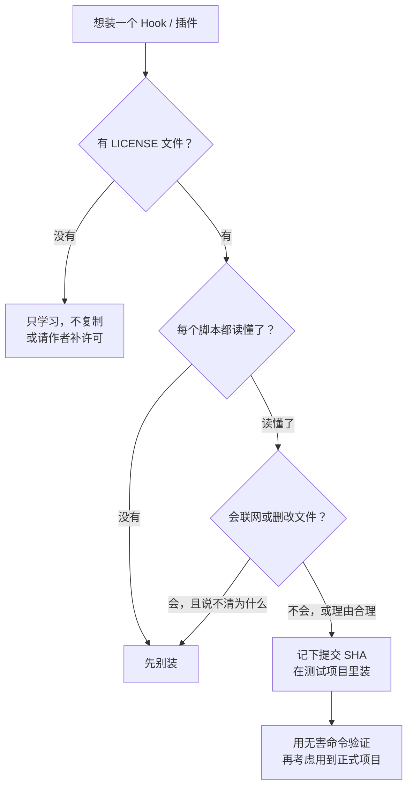

# 安装前安全清单 · Safety Checklist

[← 返回首页](../README.md) ｜ [仓库核对表](repo-catalog-v0.1.md) ｜ [入门](getting-started-v0.1.md) ｜ [小队协作模式](agent-team-pattern-v0.1.md)

**一句话：Hook 和插件脚本以你本人的权限运行，等于把电脑键盘交给陌生人一小会儿——读完再装，只给最小权限，密钥和患者信息永远不进提示词。**

> **English.** Hooks and plugin scripts run with your own permissions. Read them before installing, grant the least privilege, and never put keys or patient data in a prompt.

## 为什么要单独讲安全 · Why this matters

| 组件 | 风险来自哪里 |
| --- | --- |
| Hook | 在事件发生时**自动执行 shell 命令**，不经过模型判断，也不会每次问你 |
| 插件 | 一次安装可能同时带来技能、子智能体、钩子、MCP 服务器和脚本 |
| 子智能体 | 不写 `tools` 时继承全部工具，包括执行命令和写文件 |
| 一键安装脚本 | `curl … \| bash` 会直接运行远程脚本，内容可能随时变化 |
| Skill | 正文是文字，但可以附带脚本，也可能通过提示词引导模型执行危险操作 |

## 清单 · Checklist

### 装之前 · Before installing

- [ ] **读完每一个脚本**：Hook 指向的命令、插件里的 `hooks/`、`scripts/`、安装脚本。看不懂的那一行，就是不该装的理由
- [ ] **看清它会联网吗**：搜索 `curl`、`wget`、`fetch`、`requests`、`http` 等，确认会把什么发到哪里
- [ ] **看清它会删改什么**：搜索 `rm`、`mv`、`git push`、`git reset`、`chmod`、写入 `~/` 等
- [ ] **固定版本**：记下你审查时的提交 SHA；插件或仓库更新后要重新审查
- [ ] **一键安装脚本先下载再执行**：`curl -fsSL <URL> -o install.sh`，读完再 `bash install.sh`
- [ ] **先在测试项目里试**：不要第一次就装进有重要数据的项目或全局配置

### 许可证 · License

- [ ] **有 LICENSE 文件吗**：没有许可证 = 默认保留所有权利，可以学习，不能随意复制进自己的项目
- [ ] **开源还是源码可见**：如 `anthropics/skills` 中 `docx`、`pdf`、`pptx`、`xlsx` 为源码可见、非开源
- [ ] **README 说的和 LICENSE 文件一致吗**：只在 README 写了许可、没有 LICENSE 文件时，建议请作者补齐
- [ ] **再分发时保留署名**：MIT、Apache-2.0 都要求保留原版权和许可声明

### 最小权限 · Least privilege

- [ ] 每个子智能体都写明 `tools`，审查类角色只给 `Read, Grep, Glob`
- [ ] 不开 `bypassPermissions`，不用跳过权限确认的启动参数
- [ ] 在 `settings.json` 的 `permissions.deny` 里禁止你绝不允许的操作（如 `git push` 到主分支、读取 `.env`）
- [ ] 不同项目分开配置，个人全局目录（`~/.claude/`）只放你完全信任的东西

### 密钥 · Secrets

- [ ] **不把 API Key 贴进对话、`SKILL.md`、子智能体提示词或台账**
- [ ] Key 只放环境变量或系统钥匙串；`.env` 写进 `.gitignore`
- [ ] 提交前检查是否误提交了 `sk-`、`ghp_`、`AKIA` 一类开头的字符串（本仓库的 `tools/check-repo-v0.1.py` 会做基础检查）
- [ ] 怀疑泄露就立刻在服务商后台作废并重新生成，不要只删提交记录
- [ ] 需要 API Key 的工具（如部分编排、记忆工具）按用量计费：先设预算或用量提醒

### 医疗与科研数据 · Clinical and research data

- [ ] 可识别个人身份的患者信息（姓名、住院号、身份证号、影像中的身份信息等）不发给任何云端模型
- [ ] 受控数据库（如 MIMIC、UK Biobank）遵守数据使用协议，通常不允许上传到未经许可的第三方服务
- [ ] 以所在医院、高校的伦理审查和数据管理规定为准；不确定就先问
- [ ] AI 生成的引用、数字和结论，发表或用于临床前由本人逐条核对

### 装之后 · After installing

- [ ] 用一条**无害的测试命令**确认防护钩子确实生效
- [ ] 定期回看：装了哪些插件、哪些钩子、哪些子智能体；不用的及时删除
- [ ] 记录成本：哪些组件真正提高了保留下来的产出

## 快速判断 · Quick decision

> **English.** No license: learn, don't copy. Can't read every script: don't install. Network or file changes you can't explain: don't install. Otherwise pin the commit, try it in a test project, verify with a harmless command, then promote.
